# CyberGuard SOC Lab (`cyberguard-soc-lab-portfolio`)

[](package.json)
[](https://react.dev)
[](https://www.typescriptlang.org)
[](https://tailwindcss.com)
[](https://vitejs.dev)
[](https://bun.sh)
[](src/utils)
[](LICENSE)

> **An educational SOC dashboard simulation featuring security alert triage, event exploration, threat intelligence, Sigma detection rules, MITRE ATT&CK mapping, incident response, and reporting.**

---

## ⚠️ Important Educational Simulation Notice

> **DISCLAIMER**: **CyberGuard SOC Lab is an educational SOC dashboard simulation and training lab, NOT a production Security Information and Event Management (SIEM) system.**
>
> - **Synthetic Telemetry & Demonstration Data**: All metrics, security events, network flows, hostnames, IP addresses, domain names, file hashes, alerts, incidents, and threat indicators are **entirely synthetic demonstration fixtures**.
> - **Simulated Collectors & No Real-Time SIEM Monitoring**: Data sources, collector health statuses, connection checks, and batch ingestion are simulated locally in the browser. The application does not connect to live networks, production sensors, or real-time monitoring pipelines.
> - **Unconfigured External Threat Intelligence**: External / third-party threat intelligence integrations are not configured; IOC analysis operates exclusively on the local synthetic dataset.
> - **Simulated Response Actions**: Containment, eradication, and response playbooks (such as host isolation, process termination, firewall blocking, or credential revocation) are **strictly educational simulations** recorded in local browser storage. No actual firewall blocking, endpoint isolation, or system commands are executed.
> - **Curated Sigma & MITRE ATT&CK Subsets**: Sigma detection rules and MITRE ATT&CK mappings represent the implemented educational demonstration subset rather than full platform or complete knowledge-base compatibility.
> - **Safe Defanging**: Threat indicators are neutralized for safe inspection (`hxxp://`, `[.]`).

---

## Overview

CyberGuard SOC Lab provides security students, homelab practitioners, and aspiring blue-team defenders with an interactive, hands-on Security Operations Center simulation interface. Built with **React 19**, **TypeScript**, and **Tailwind CSS v4**, the application models end-to-end SOC workflows using local synthetic telemetry: from simulated log ingestion and local Sigma rule evaluation to curated MITRE ATT&CK coverage analysis, structured incident triage, forensic timeline tracking, and formal investigation reporting.

The interface is styled with a **Midnight Blue + Electric Cyan** theme, featuring synchronized toggling between **Dark Mode** and **Light Mode** with local persistence.

---

## Screenshots

> Screenshot assets are cataloged in [`docs/screenshots/`](docs/screenshots/README.md).

| SOC Overview (Dark Mode) | Security Alerts Triage (Dark Mode) |
| :---: | :---: |
| 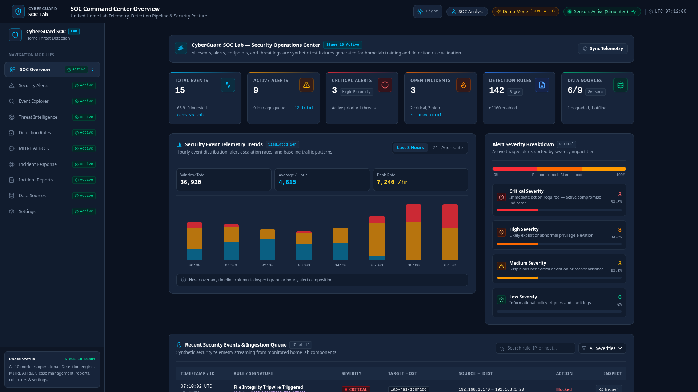 | 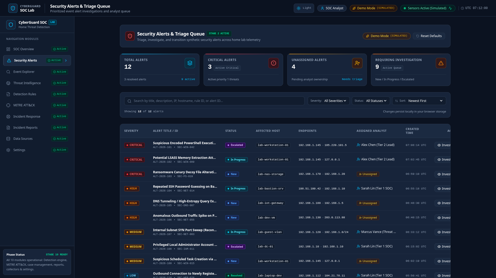 |

| Event Explorer (Dark Mode) | Threat Intelligence (Dark Mode) |
| :---: | :---: |
| 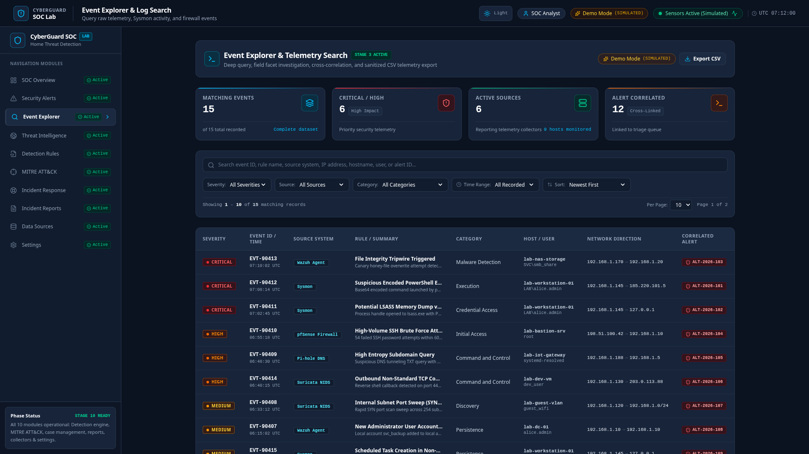 | 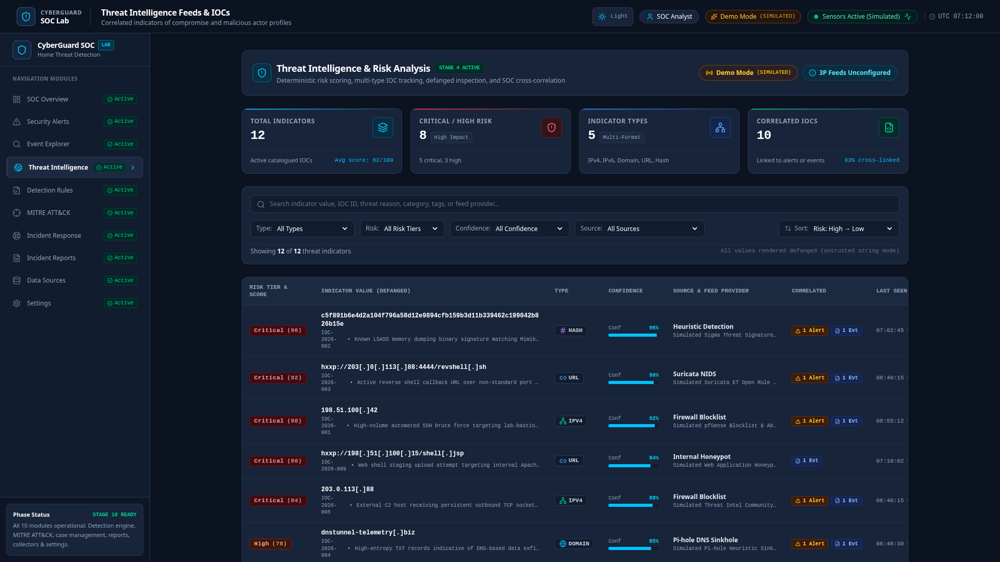 |

| Sigma Detection Rules (Dark Mode) | MITRE ATT&CK Matrix (Dark Mode) |
| :---: | :---: |
| 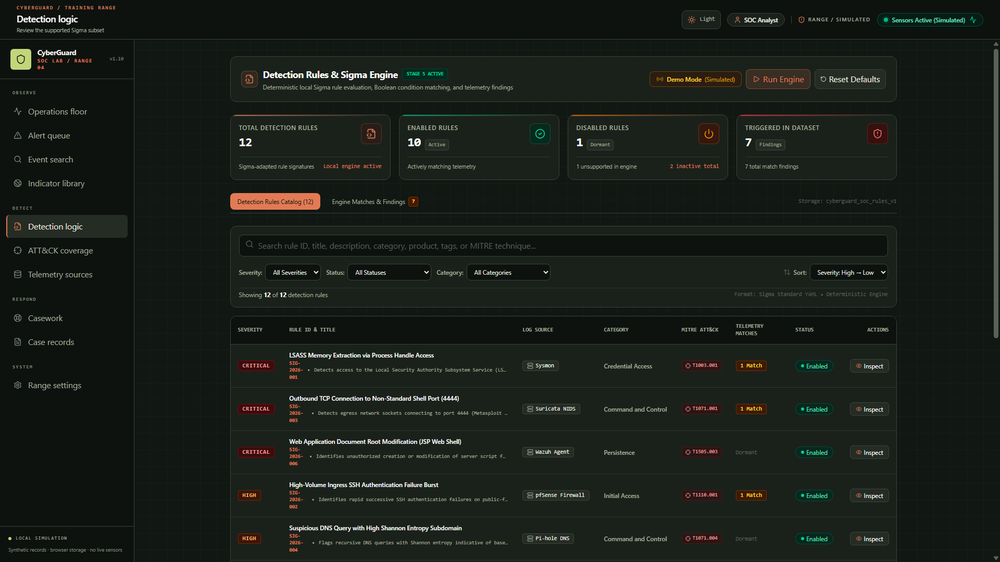 | 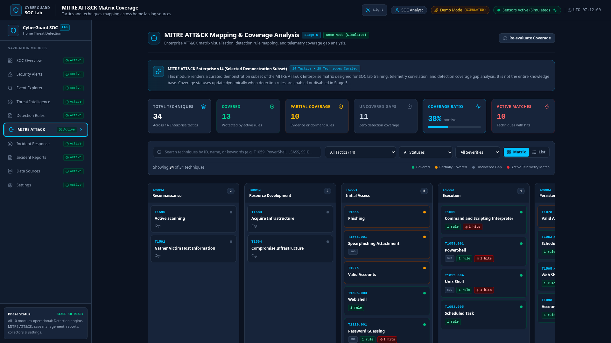 |

| Incident Response & Cases (Dark Mode) | Incident Documentation (Dark Mode) |
| :---: | :---: |
| 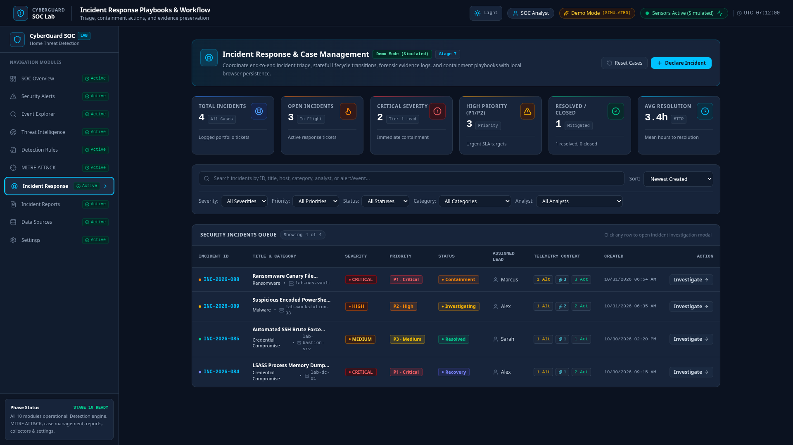 | 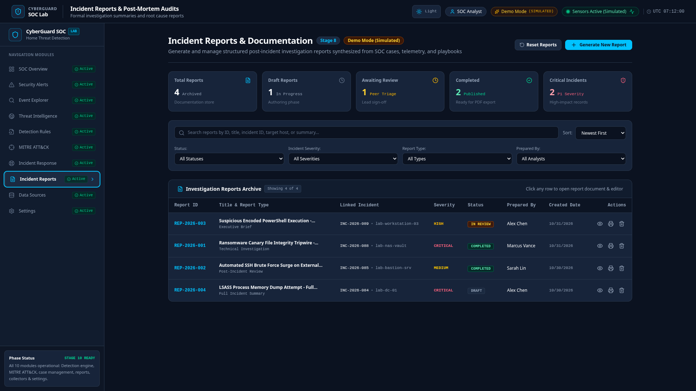 |

| Data Sources & Collectors (Dark Mode) | Settings & Storage Inspector (Dark Mode) |
| :---: | :---: |
| 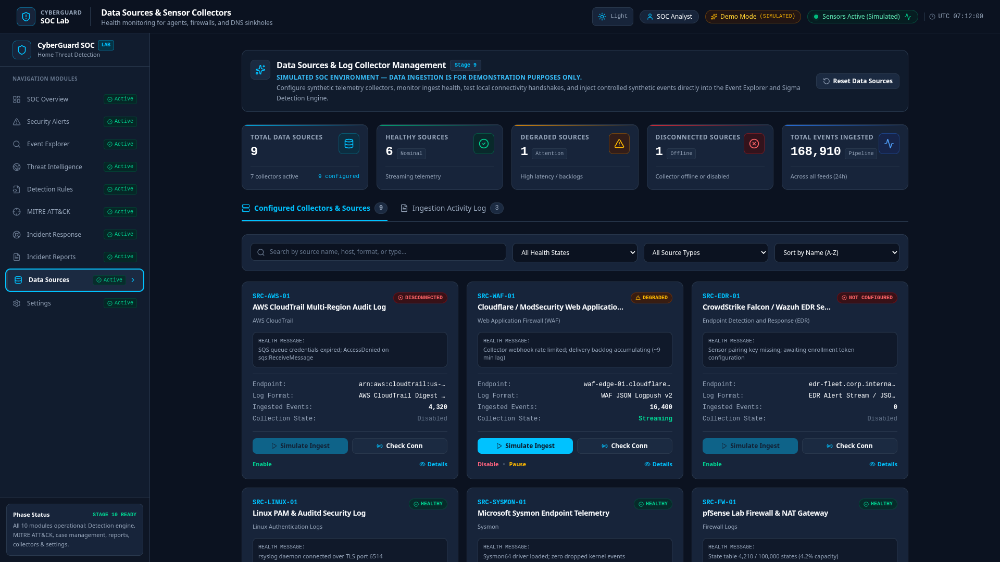 | 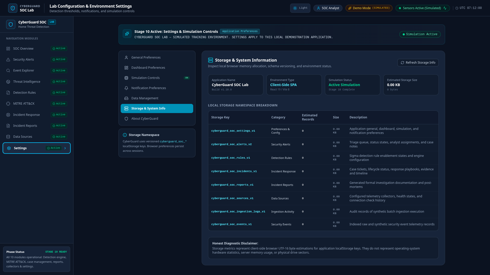 |

| SOC Overview (Light Mode) | Security Alerts Triage Queue (Light Mode) |
| :---: | :---: |
| 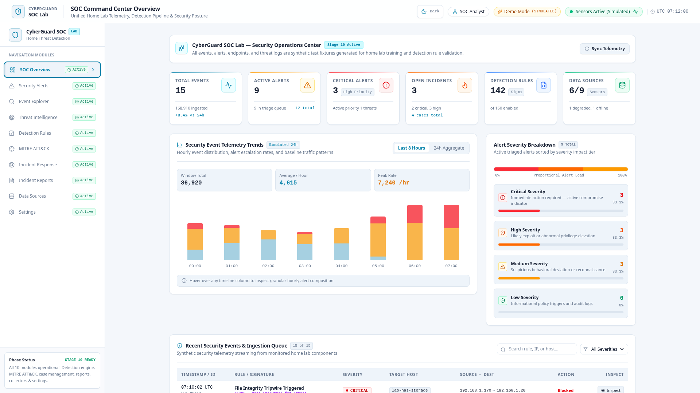 | 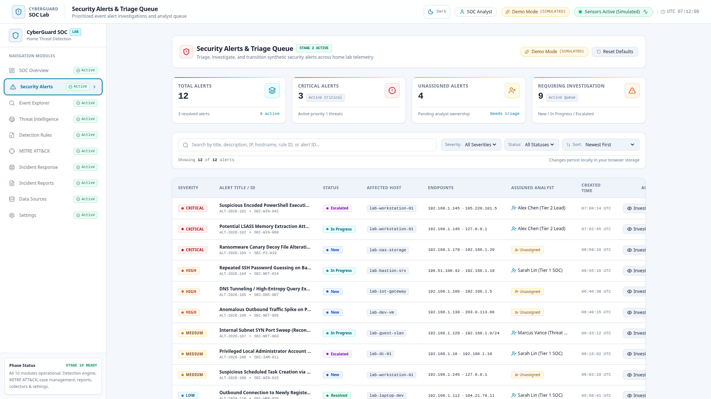 |

---

## The 10 Core Modules

CyberGuard SOC Lab comprises 10 integrated educational SOC modules:

### 1. SOC Overview Dashboard
* **Operational KPI Cards**: Dynamic counters for Total Events, Active Alerts, Critical Alerts, Open Incidents, Detection Rules, and Data Sources derived from the local dataset.
* **Telemetry Volume Trends**: Interactive simulated 24-hour trend chart displaying hourly event volume distributions with 8-hour and 24-hour window toggles and hover breakdowns.
* **Alert Severity Distribution**: Proportional severity load bar and tier breakdown sorting active triaged alerts into Critical, High, Medium, and Low categories.
* **Recent Events Stream**: Interactive tabular stream of indexed synthetic security events with instant search, severity filters, and a raw event detail modal.
* **Sensor & Collector Health Grid**: Dynamic status indicator cards reflecting simulated collector health states across the lab topology.

### 2. Security Alerts & Incident Triage
* **Dedicated Triage Queue**: High-density queue displaying active, escalated, and resolved synthetic security alerts.
* **Multi-Field Search & Filtering**: Case-insensitive filtering across alert ID, title, description, source/destination IP, affected asset hostname, and detection rule ID.
* **Lifecycle State Machine**: Enforced SOC status transition paths:
  - `New` → `In Progress` | `Escalated`
  - `In Progress` → `Escalated` | `Resolved`
  - `Escalated` → `In Progress` | `Resolved`
  - `Resolved` → `In Progress` *(Reopening)*
* **Alert Detail & Investigation Modal**: Comprehensive inspection drawer providing:
  - Severity, status, and affected asset telemetry.
  - Bidirectional links to correlated synthetic events and MITRE ATT&CK techniques.
  - Analyst assignment selector (`Alex Chen`, `Sarah Lin`, `Marcus Vance`, or `Unassigned`).
  - Chronological case notes journal with author attribution and timestamps.
  - One-click incident escalation button creating a linked case in Stage 7.

### 3. Event Explorer
* **Multi-Source Log Exploration**: Search and analyze synthetic security events modeled after network firewalls, endpoints, authentication servers, and intrusion detection systems.
* **Forensic Event Filtering**: Filter by severity, simulated collector system (pfSense, Sysmon, Suricata, Pi-hole DNS, Wazuh Agent, etc.), category, and time window.
* **Pagination & Table Controls**: Smooth pagination (10 items per page) with record index counters.
* **Forensic Inspector Drawer**: Deep-dive modal revealing normalized event fields, raw syslog/JSON payload format, process command lines, and correlated alert links.
* **Spreadsheet-Safe CSV Export**: Export filtered telemetry datasets to CSV with built-in formula-injection mitigation (neutralizing `=`, `+`, `-`, and `@` prefixes).

### 4. Threat Intelligence & Risk Analysis
* **Curated Synthetic IOC Repository**: Indicator of Compromise catalog covering 5 standard indicator types: IPv4, IPv6, FQDN/Domain, URL, and Cryptographic File Hash (SHA-256). External third-party threat intelligence feeds are explicitly marked as unconfigured (`3P Feeds Unconfigured`).
* **Deterministic Risk Scoring Engine**: Calculates indicator risk scores strictly bounded between 1 and 100 based on threat source credibility, recency, observed sightings, and severity class.
* **Confidence vs. Risk Decoupling**: Explicitly separates confidence assessment (analyst certainty) from severity risk score.
* **Defanged Presentation**: Automatic indicator defanging (`hxxp://`, `example[.]com`, `198.51.100[.]42`) to prevent accidental navigation or DNS resolution during training.
* **Correlation Badges**: Dynamic cross-correlation with local triage alerts and synthetic telemetry events.

### 5. Sigma Detection Rules & Detection Engine
* **Sigma-Adapted Demonstration Catalog**: 12 curated detection rules targeting common adversary techniques (PowerShell download cradles, LSASS memory access, Kerberoasting, SSH brute forcing, etc.).
* **Deterministic Local Evaluation Engine (Implemented Subset)**:
  - Evaluates a documented local subset of Sigma syntax: logsource criteria, structured field comparisons (`exact`, `contains`, `startswith`, `endswith`, `gt`, `gte`, `in`), and Boolean conditions (`AND` / `OR`).
  - Safe execution guarantee: Rules requiring unsupported operators (such as sliding temporal correlation windows or regex aggregations) are explicitly flagged as *Unsupported in Engine* rather than silently failing or fabricating false matches.
* **Interactive Rule Toggling**: Analysts can toggle rules enabled/disabled interactively. The local detection engine immediately recalculates findings and updates coverage counters with persistent localStorage state (`cyberguard_soc_rules_v1`).

### 6. MITRE ATT&CK Mapping & Coverage Analysis
* **Curated Matrix Visualization (Demonstration Subset)**: Interactive matrix rendering a curated demonstration subset of MITRE ATT&CK Enterprise v14 across 14 tactics (from Reconnaissance through Impact) rather than the full knowledge base.
* **Coverage Assessment Engine**: Dynamically categorizes each curated technique into:
  - 🟢 **Covered**: Mapped to active, enabled detection rules in the local catalog.
  - 🟡 **Partially Covered**: Mapped to dormant rules or observed telemetry without full active rule coverage.
  - 🔴 **Gap / Uncovered**: Threat techniques currently lacking detection rules in the local catalog.
* **Technique Deep-Dive Modal**: Displays technique ID, sub-technique hierarchy, tactic taxonomy, associated Sigma rules, correlated alerts, synthetic telemetry events, and cross-navigation shortcuts.

### 7. Incident Response & Case Management
* **Structured Incident Tracker**: Manage simulated security incidents across standard lifecycle phases:
  - `New` → `Investigating` → `Containment` → `Eradication` → `Recovery` → `Resolved` → `Closed`.
* **Multi-Tab Incident Dossier**:
  - **Overview & Notes**: Summary scope, severity, priority (P1–P4), assigned lead investigator, and interactive investigation notes logging.
  - **Audit Timeline**: Chronological event journal recording case escalation, analyst assignments, status transitions, and simulated playbook executions.
  - **Evidence Repository**: Catalog of attached synthetic forensic evidence (hashes, IP addresses, log extracts, process dumps).
  - **Simulated Response Playbooks**: Documented containment and eradication actions (such as Host Isolation, ZFS Snapshot Creation, and Kerberos Ticket Revocation) recorded locally for SOC training—no actual firewall blocking or endpoint isolation is performed.
  - **Correlated Data**: Direct cross-links to triggering alerts and synthetic telemetry events.

### 8. Incident Reports & Documentation
* **Structured Investigation Post-Mortems**: Synthesizes structured demonstration incident reports directly from Stage 7 incident records.
* **Standard 11-Section Investigation Report**:
  1. Executive Summary
  2. Incident Overview & Classification
  3. Investigation Scope & Evaluated Data Sources
  4. Chronological Timeline Summary
  5. Technical Forensic Findings
  6. Threat Intelligence & Indicator Analysis
  7. MITRE ATT&CK Framework Mapping
  8. Response & Containment Playbook Actions
  9. Impact Assessment & Blast Radius
  10. Recommendations & Corrective Action Plan
  11. Conclusion & Investigator Sign-Off
* **Stale Snapshot Detection & Refresh**: Alerts the analyst if the underlying incident record has been modified after report generation, allowing non-destructive section refreshing while preserving custom analyst observations.
* **Print & PDF Optimization**: Clean print stylesheet optimized for saving or printing structured PDF reports directly from the browser.

### 9. Data Sources & Log Collector Management
* **Simulated Log Collector Grid**: Manage 9 simulated data source models representing common home-lab and organizational telemetry feeds:
  - Windows Security & System Event Logs (EVTX)
  - Microsoft Sysmon Endpoint Telemetry
  - Linux PAM & Auditd Security Logs
  - Zeek Network Security Monitor
  - Suricata NIDS/IPS Sensor Engine
  - pfSense Lab Firewall & NAT Gateway
  - Cloudflare / ModSecurity Web Application Firewall (WAF)
  - AWS CloudTrail Multi-Region Audit Log
  - CrowdStrike Falcon / Wazuh EDR Sensor Fleet
* **Diagnostic Handshake Simulator**: Simulates local collector connection checks, latency readouts (ms), and health diagnostics without contacting external hosts.
* **Controlled Synthetic Ingestion Engine**: Triggers batch ingestion of synthetic security telemetry (batches of 5, 10, 25, or 50 events) that dynamically feed the Event Explorer and local detection engine.
* **Ingestion Activity Log**: Tracks simulated ingestion runs, source identifiers, batch sizes, and timestamps.

### 10. Settings & Simulation Controls
* **Centralized Configuration Dashboard**:
  - **General Preferences**: Analyst display name, default landing module, date formats (ISO 8601, US, International), time zone selection (UTC, EST, PST, GMT, JST), 12h/24h clock, and table row density (Comfortable vs Compact).
  - **Dashboard Preferences**: Configurable refresh display preferences, trend chart window defaults, and widget visibility toggles.
  - **Simulation Controls**: Global simulation enable/disable toggle, synthetic anomaly settings, and ingestion controls.
  - **Notification Preferences**: In-app alert banners and severity-specific notification thresholds.
  - **Data Management**: Local record inventory breakdown across all 8 record categories, schema-validated full JSON backup export, structured JSON backup restoration with preview, and confirmation-protected scoped resets.
  - **Storage & System Info**: Client-side UTF-16 byte estimations and record counts across all `cyberguard_soc_*` localStorage keys.
  - **About CyberGuard**: Versioning details, runtime environment metadata, and educational simulation disclosures.

---

## Design System: Midnight Blue + Electric Cyan

CyberGuard SOC Lab features a custom **Midnight Blue + Electric Cyan** design system:

* **Dark Mode**:
  - Deep midnight blue base (`#0B1220`) with layered surface cards (`#111C30`, `#17243A`).
  - Electric cyan accents (`#06B6D4`, `#22D3EE`, `#00F0FF`) for active tabs, borders, and interactive states.
  - Balanced high-contrast text (`#F8FAFC`, `#CBD5E1`, `#94A3B8`).
* **Light Mode**:
  - Crisp, professional slate and white canvas (`#F8FAFC`, `#FFFFFF`) with subtle cool-grey borders (`#E2E8F0`).
  - High-contrast typography (`#0F172A`, `#334155`) ensuring readable tables and metric cards.
* **Theme Switching & Synchronization**:
  - Instant theme toggle available in the header and Settings module.
  - Full synchronization between controls and instant DOM class switching.
  - Persistent storage across browser sessions (`cyberguard_soc_settings_v1`).
* **Responsive Architecture**:
  - Seamless layouts across Desktop (1920×1080, 1440×900), Tablet (768×1024), and Mobile (375×667).
  - Mobile slide-out drawer navigation with accessible dialog semantics.

---

## Architecture & State Management

```
┌─────────────────────────────────────────────────────────────┐
│                    CyberGuard SOC Lab                       │
│                        (React 19)                           │
└──────────────────────────────┬──────────────────────────────┘
                               │
       ┌───────────────────────┼───────────────────────┐
       ▼                       ▼                       ▼
┌──────────────┐       ┌──────────────┐        ┌──────────────┐
│  Navigation  │       │  10 Domain   │        │ LocalStorage │
│   Sidebar    │       │ Modules & UI │        │ Persistence  │
└──────────────┘       └───────┬──────┘        └───────▲──────┘
                               │                       │
       ┌───────────────────────┴───────────────┐       │
       ▼                                       ▼       │
┌─────────────────────────┐         ┌──────────────────┴──────┐
│ Deterministic Detection │         │   Versioned Storage     │
│   & Analytics Engine    │         │      Namespaces         │
│  - Sigma Rule Evaluator │         │ - settings_v1           │
│  - MITRE Matrix Mapper  │         │ - alerts_v2             │
│  - IOC Risk Calculator  │         │ - rules_v1              │
│  - Metrics Aggregator   │         │ - incidents_v1          │
│  - Report Generator     │         │ - reports_v1            │
└─────────────────────────┘         │ - sources_v1            │
                                    │ - events_v1             │
                                    └─────────────────────────┘
```

### Persistence Namespace Model
All data is stored exclusively in client-side `localStorage` under strictly isolated keys. Non-CyberGuard browser storage is never touched:

| Storage Key | Content Description |
|---|---|
| `cyberguard_soc_settings_v1` | General preferences, theme mode, display options, and simulation controls |
| `cyberguard_soc_alerts_v2` | Triage queue, status states, analyst assignments, and case notes |
| `cyberguard_soc_rules_v1` | Sigma detection rule enablement flags |
| `cyberguard_soc_incidents_v1` | Case management tickets, audit timelines, evidence, and playbooks |
| `cyberguard_soc_reports_v1` | Generated formal investigation reports and draft post-mortems |
| `cyberguard_soc_sources_v1` | Configured data sources, collector health states, and check history |
| `cyberguard_soc_ingestion_logs_v1` | Telemetry batch ingestion execution audit log |
| `cyberguard_soc_events_v1` | Indexed security events and simulated ingested records |

---

## Technology Stack

| Layer | Technology | Purpose |
|---|---|---|
| **Frontend Framework** | React 19 (`react`, `react-dom`) | Modern component architecture, functional hooks, concurrent rendering |
| **Language** | TypeScript 7.0 (`typescript`) | Strict type safety, shared domain interfaces, enums |
| **Build Tool & Bundler** | Vite 8.3 (`vite`, `@vitejs/plugin-react`) | Rapid HMR, optimized ESM bundling, zero-overhead development |
| **Styling** | Tailwind CSS v4.3 (`@tailwindcss/vite`, `tailwindcss`) | Utility-first responsive design, theme-driven variables |
| **Package Manager & Runtime** | Bun 1.4 (`bun.lock`) | Fast dependency management, locked reproducible installs, CI pipeline |
| **Iconography** | Lucide React (`lucide-react`) | Enterprise security, networking, and triage iconography |
| **Animations** | Motion (`motion`) | Smooth modal transitions and UI drawer animations |
| **Testing** | Node.js Test Runner / Bun Test (`node:test`, `tsx --test` / `bun test`) | Blazing-fast native TypeScript unit test execution (109 passing tests) |

---

## Project Structure

```
cyberguard-soc-lab-portfolio/     # Repository root (npm package: cyberguard-soc-lab)
├── .env.example                  # Environment variable reference (zero secrets)
├── .github/
│   └── workflows/
│       └── ci.yml                # GitHub Actions CI workflow (Bun test, lint, build)
├── .gitignore                    # Comprehensive Git ignore rules
├── bun.lock                      # Authoritative Bun lockfile for reproducible installs
├── index.html                    # Application entry HTML document
├── LICENSE                       # MIT License
├── package.json                  # Project manifest, dependencies, and scripts
├── SECURITY.md                   # Security policy & vulnerability reporting guidance
├── tsconfig.json                 # TypeScript compiler configuration
├── vite.config.ts                # Vite build and plugin setup
├── docs/
│   ├── CASE_STUDY.md             # Architectural & educational SOC workflow case study
│   └── screenshots/              # Verified application screenshots (12 PNG assets)
│       └── README.md             # Screenshot catalog and specifications
├── public/                       # Static public assets
└── src/
    ├── App.tsx                   # Root application component & module router
    ├── main.tsx                  # React 19 DOM mount entry point
    ├── index.css                 # Global CSS and Tailwind CSS v4 directives
    ├── components/
    │   ├── alerts/               # Security Alerts triage queue & detail modal
    │   ├── dashboard/            # SOC Overview KPI cards, charts, and tables
    │   ├── events/               # Event Explorer table, filters, and inspector
    │   ├── incidents/            # Incident Response case management & playbooks
    │   ├── intel/                # Threat Intelligence IOC view & risk scoring
    │   ├── layout/               # Header, Sidebar, and navigation components
    │   ├── mitre/                # MITRE ATT&CK matrix and technique drawer
    │   ├── placeholders/         # Modular fallback view placeholders
    │   ├── reports/              # Incident report generator, viewer, and print
    │   ├── rules/                # Sigma detection rules catalog and engine view
    │   ├── settings/             # Settings, storage inspector, and backup modal
    │   └── sources/              # Data sources, collectors, and ingestion modal
    ├── data/
    │   ├── mockSocData.ts        # Baseline synthetic alerts, events, and IOCs
    │   ├── mockDetectionRules.ts # Pre-configured Sigma detection rules
    │   ├── mockMitreData.ts      # Curated MITRE ATT&CK tactics & techniques
    │   ├── mockIncidentsData.ts  # Baseline security incident cases
    │   ├── mockReportsData.ts    # Initial formal incident report records
    │   └── mockDataSourcesData.ts# Baseline log collectors & telemetry configs
    ├── types/
    │   └── soc.ts                # Unified domain TypeScript interfaces & enums
    └── utils/
        ├── alerts.ts / .test.ts        # Alert triage utilities & tests
        ├── dataSources.ts / .test.ts   # Collector management & tests
        ├── detectionEngine.ts / .test.ts # Sigma rule engine & tests
        ├── events.ts / .test.ts        # Telemetry processing, CSV & tests
        ├── incidents.ts / .test.ts     # Incident lifecycle state machine & tests
        ├── metrics.ts / .test.ts       # KPI calculation utilities & tests
        ├── mitreAttack.ts / .test.ts   # ATT&CK coverage algorithm & tests
        ├── reports.ts / .test.ts       # Report generator & refresh tests
        ├── settings.ts / .test.ts      # Settings persistence & backup tests
        ├── themeClasses.ts             # Midnight Blue theme class utilities
        └── threatIntel.ts / .test.ts   # Threat intelligence risk scoring & tests
```

---

## Getting Started

### Prerequisites
- **Bun**: v1.1.0 or higher (v1.4+ recommended — the authoritative lockfile is `bun.lock`, which is also used in GitHub Actions CI)
- *Alternative*: **Node.js**: v20.0.0 or higher with **npm**: v10.0.0 or higher

### Installation
Clone the repository and install dependencies using **Bun** (recommended, respecting `bun.lock`):

```bash
git clone https://github.com/aditya77288-web/cyberguard-soc-lab-portfolio.git
cd cyberguard-soc-lab-portfolio
bun install --frozen-lockfile
```

> **Note for npm users**: You can alternatively run `npm install`. Note that `bun.lock` is the authoritative lockfile checked into the repository and validated by CI.

### Development Server
Launch the local development server on `http://localhost:3000`:

```bash
# Using Bun (Recommended)
bun run dev

# Or using npm
npm run dev
```

### Production Build
Compile TypeScript and generate an optimized production bundle:

```bash
# Using Bun (Recommended)
bun run build

# Or using npm
npm run build
```

Preview the production build locally:

```bash
# Using Bun (Recommended)
bun run preview

# Or using npm
npm run preview
```

### Running Tests
Execute the comprehensive 109-test suite across all 10 domain modules:

```bash
# Using Bun (Instant execution via native test runner)
bun test

# Or using npm / tsx (Node.js test runner)
npm test

# Direct tsx execution
npx tsx --test src/utils/*.test.ts
```

---

## Automated Test Suite

The test suite covers pure business logic, metric calculations, filtering, and storage operations using Node.js's native test runner (`node:test` and `node:assert/strict`):

* **109 Unit Tests Across 10 Test Suites**:
  - `alerts.test.ts`: Triage lifecycle transitions, priority calculation, filtering, case note appending.
  - `dataSources.test.ts`: Collector status assessment, simulated connection checks, ingestion pipeline.
  - `detectionEngine.test.ts`: Sigma rule condition parser, operator evaluation, safe execution guarantees.
  - `events.test.ts`: Telemetry search, multi-source filtering, spreadsheet formula-injection neutralization.
  - `incidents.test.ts`: Incident state machine transitions, chronological timeline creation, playbook actions.
  - `metrics.test.ts`: Aggregation accuracy, severity distributions, EPS throughput formulas.
  - `mitreAttack.test.ts`: Deterministic coverage categorization, technique mapping, gap detection.
  - `reports.test.ts`: 11-section report compilation, stale snapshot detection, non-destructive section refresh.
  - `settings.test.ts`: Schema-validated backup export/import, corrupt JSON recovery, scoped reset boundaries.
  - `threatIntel.test.ts`: Deterministic 1–100 risk scoring, indicator normalization, safe defanging.

---

## Security & Privacy Disclosures

* **Zero Hardcoded Secrets**: The codebase contains **zero** hardcoded credentials, API tokens, passwords, private keys, or corporate endpoints.
* **Client-Side Operation**: All telemetry processing and rule evaluation occur locally within the browser. No telemetry or user data is transmitted to external servers.
* **Safe Demonstrations**: Indicator links are neutralized; firewall commands and network isolation triggers are sandboxed simulations.

---

## Known Limitations

1. **Educational Simulation Only (Not a Production SIEM)**: All telemetry, collectors, alerts, and incidents are synthetic demonstration data. The application does not perform real-time production SIEM monitoring.
2. **Unconfigured External Threat Intelligence**: Third-party threat intelligence feeds and external enrichment APIs are not configured.
3. **Simulated Response Actions**: Containment and eradication actions recorded in Incident Response are local workflow records and do not perform actual firewall blocking, process termination, or endpoint isolation.
4. **Sigma & MITRE ATT&CK Demonstration Subsets**: The local detection engine implements a documented safe subset of Sigma syntax (logsource, structured comparison operators, and Boolean conditions); sliding time windows and regex aggregations are safely flagged as *Unsupported in Engine*. Likewise, the MITRE ATT&CK matrix renders a curated demonstration subset of techniques rather than the entire ATT&CK knowledge base.
5. **Simulated Collectors**: The Data Sources module simulates collector health diagnostics, latency handshakes, and synthetic batch ingestion without opening network sockets or connecting to live sensors.
6. **Browser LocalStorage Quota**: Data persistence uses client-side browser `localStorage` (typically ~5MB quota), which bounds the volume of locally stored synthetic ingestion records.

---

## Contributing

Contributions, feedback, and issue reports are welcome!
1. Fork the Project
2. Create your Feature Branch (`git checkout -b feature/AmazingFeature`)
3. Commit your Changes (`git commit -m 'Add some AmazingFeature'`)
4. Ensure all tests pass (`bun test` or `npm test`, and `bun run lint` or `npm run lint`)
5. Push to the Branch (`git push origin feature/AmazingFeature`)
6. Open a Pull Request

---

## License

Distributed under the **MIT License**. See [`LICENSE`](LICENSE) for details.
